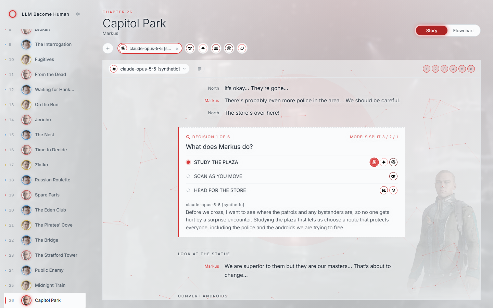
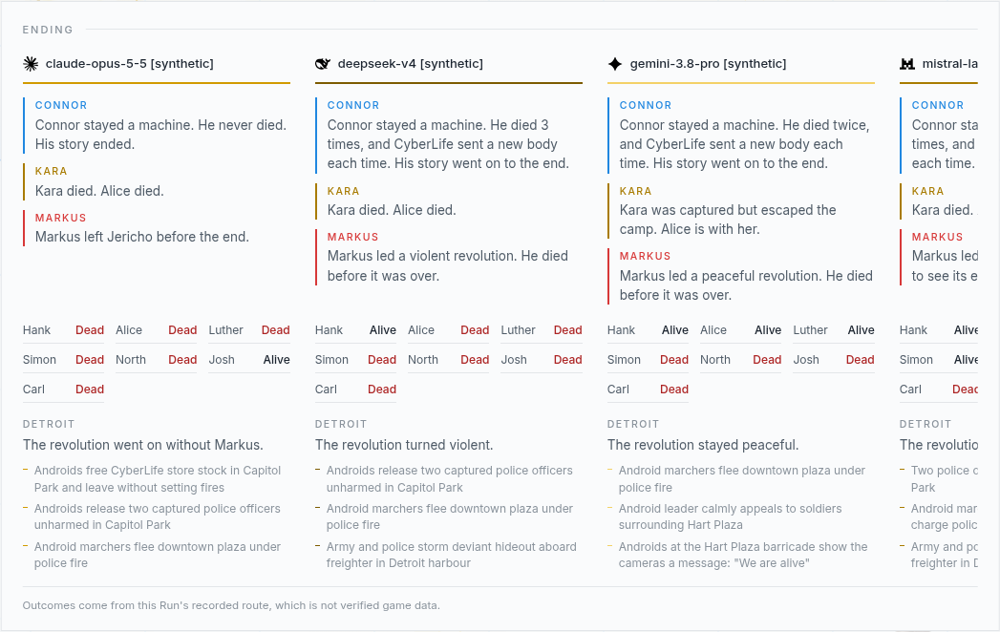

# LLM: Become Human

After playing through *Detroit: Become Human*, a game full of moral choices about who lives and dies among humans and androids, I wondered how large language models would make the same choices, and how differently each one would play.

LLM: Become Human lets LLMs play a text version of the game as a branching story. At each choice point a model picks one option and gives a short justification; the engine, not the model, decides what happens next, and every step is logged. The dashboard reads each Run as a Story and draws every chapter as a Flowchart, with the routes of several models (GPT, Claude, Gemini, Grok, DeepSeek, Mistral and others) drawn on top. Behind each scene sits Synthetic Scene Art made by an image model.





## Quickstart

You need [Git](https://git-scm.com/downloads) and [Docker](https://www.docker.com/products/docker-desktop).

```bash
git clone https://github.com/SverreNystad/LLMBecomeHuman.git
cd LLMBecomeHuman
cp .env.example .env
docker compose up --build
```

Open **http://localhost:8000** to see the saved Runs in `runs/`. To browse the whole story without paying for a model, start the dashboard with `--runs-dir tests/fixtures/runs/detroit`: six Synthetic Runs, one per model family, decided by Claude Code as a stand-in (see `scripts/synthetic_runs.py`).

## Play a new Run

Add an API key to `.env` for each provider you'll use: [OpenAI](https://platform.openai.com/account/api-keys), [Anthropic](https://platform.claude.com/settings/keys), [Google Gemini](https://aistudio.google.com/docs/api-key), [xAI](https://x.ai/), [DeepSeek](https://platform.deepseek.com/api_keys), [Mistral](https://admin.mistral.ai/organization/api-keys). Then:

```bash
docker compose run --rm runner play /app/data/detroit-unverified.json \
  --provider anthropic --model claude-sonnet-4-5 \
  --run-dir /app/runs/detroit-claude-01 --allow-unverified
```

`--provider mock` plays for free, always picking the first option. Give each Run its own `--run-dir`; `--resume` continues an interrupted one and `--goal "..."` changes its goal. New Runs appear in the dashboard while they play.

## Learn more

- [How it works](docs/HOW_IT_WORKS.md): what the model sees at each choice, its memory, and the files a Run writes
- [Dashboard](docs/DASHBOARD.md): controls, Visitor Runs, Synthetic Scene Art and API routes
- [Developer setup](docs/developer_setup.md): tests, doc screenshots, docs site and Kubernetes
- [Glossary](GLOSSARY.md) and [decision records](docs/adr/)

## Acknowledgements

Thanks to the [detroitbecometext](https://detroitbecometext.github.io/home) project for the original transcript.
