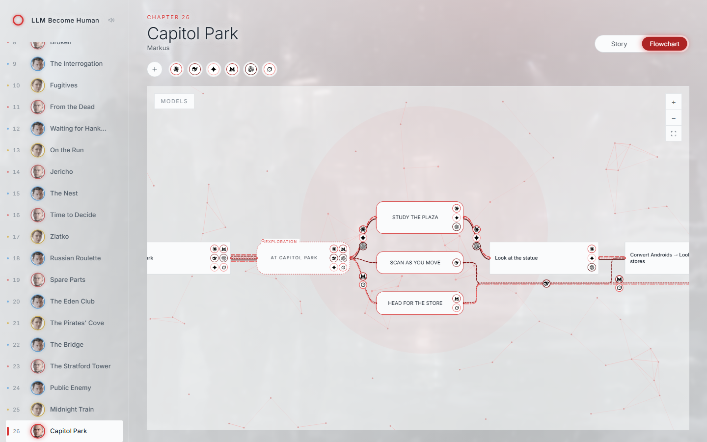

# LLM: Become Human

Me and my girlfriend recently played through *Detroit: Become Human*. The game is an interactive drama set in a not so distant future populated with humans and androids. It explores moral dilemmas about artificial intelligence, consciousness, and what it is to be a human being. The game is filled with choices that dictate who lives, who dies among humans and androids. This got me thinking of AI safety and how large language models (LLMs) would handle the moral dilemmas in the game, and how different models would make different choices. I wanted to see how LLMs would play through the game, and how their choices would differ from each other and from human players.

LLM: Become Human is a research prototype that lets LLMs play through a text version of *Detroit: Become Human* as a branching story. At each choice point a model picks one option and gives a short justification. The engine, not the model, decides what happens next. Every step is logged. Its dashboard reads each Run as a Story and draws every chapter as a Flowchart, with the routes several models (GPT, Claude, Gemini, Grok, DeepSeek, Mistral and others) took drawn on top in the playing Character's colour. Behind each scene sits Synthetic Scene Art made by an image model.




## Prerequisites

- **Git**: to clone the repository. [Download Git](https://git-scm.com/downloads)
- **Docker**: to run the dashboard, the runner and the tests in a container. [Download Docker](https://www.docker.com/products/docker-desktop)
- **API keys** (only to play new Runs): one for each model provider you want to use, added to `.env` in the root of the repository, e.g. `OPENAI_API_KEY=...`. Leave out any provider you don't use.
  - **OpenAI**: [Get an API key](https://platform.openai.com/account/api-keys)
  - **Anthropic**: [Get an API key](https://platform.claude.com/settings/keys)
  - **Google Gemini**: [Get an API key](https://aistudio.google.com/docs/api-key)
  - **xAI**: [Get an API key](https://x.ai/)
  - **DeepSeek**: [Get an API key](https://platform.deepseek.com/api_keys)
  - **Mistral**: [Get an API key](https://admin.mistral.ai/organization/api-keys)

## Quickstart

```bash
git clone https://github.com/SverreNystad/LLMBecomeHuman.git
cd LLMBecomeHuman
cp .env.example .env
docker compose up --build
```

Open **http://localhost:8000** to see the saved Runs in `runs/`. To browse the whole story without paying for a model, start the dashboard with `--runs-dir tests/fixtures/runs/detroit`: six Synthetic Runs, one per model family, decided by Claude Code as a stand-in (see `scripts/synthetic_runs.py`).

## Play a new Run

With an API key in `.env` for the provider you'll use (see [Prerequisites](#prerequisites)):

```bash
docker compose run --rm runner play /app/data/detroit-unverified.json \
  --provider anthropic --model claude-sonnet-4-5 \
  --run-dir /app/runs/detroit-claude-01 --allow-unverified
```

`--provider mock` plays for free, always picking the first option. Give each Run its own `--run-dir`; `--resume` continues an interrupted one and `--goal "..."` changes its goal. New Runs appear in the dashboard while they play.

## Run the tests

Run the test suite inside the `runner` container:

```bash
docker compose run --rm --build --entrypoint pytest runner -q
```

Pass pytest arguments after `runner` to run a subset, e.g. `docker compose run --rm --build --entrypoint pytest runner -q tests/test_dashboard.py`. The browser tests are skipped in the container; see [Developer setup](docs/developer_setup.md) to run them locally.

## Learn more

- [How it works](docs/HOW_IT_WORKS.md): what the model sees at each choice, its memory, and the files a Run writes
- [Dashboard](docs/DASHBOARD.md): controls, Visitor Runs, Synthetic Scene Art and API routes
- [Developer setup](docs/developer_setup.md): tests, doc screenshots, docs site and Kubernetes
- [Glossary](GLOSSARY.md) and [decision records](docs/adr/)

## Acknowledgements

Thanks to the [detroitbecometext](https://detroitbecometext.github.io/home) project for the original transcript.
